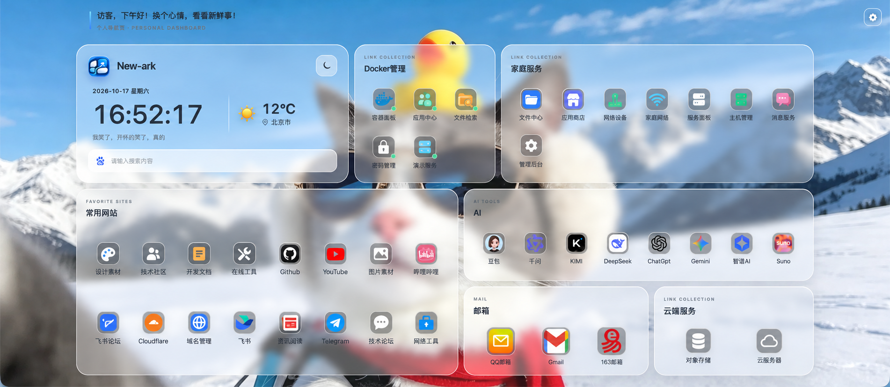
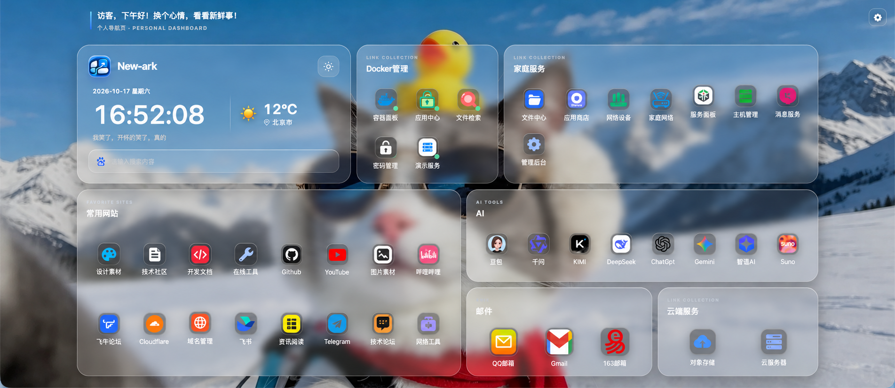
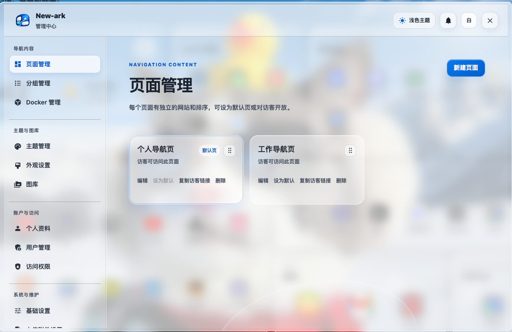
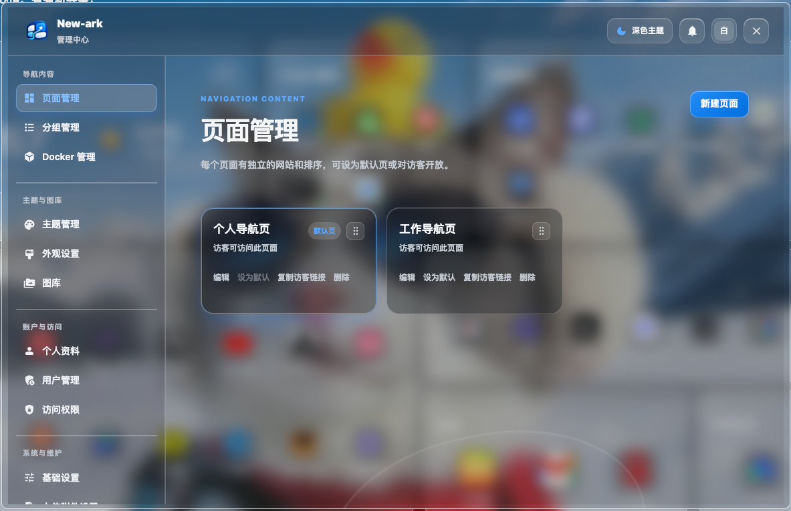
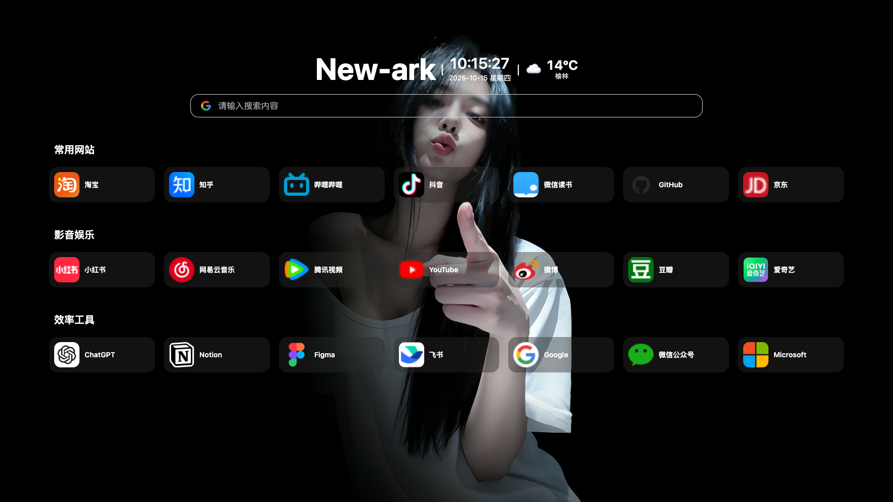
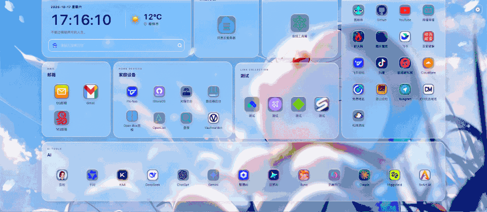
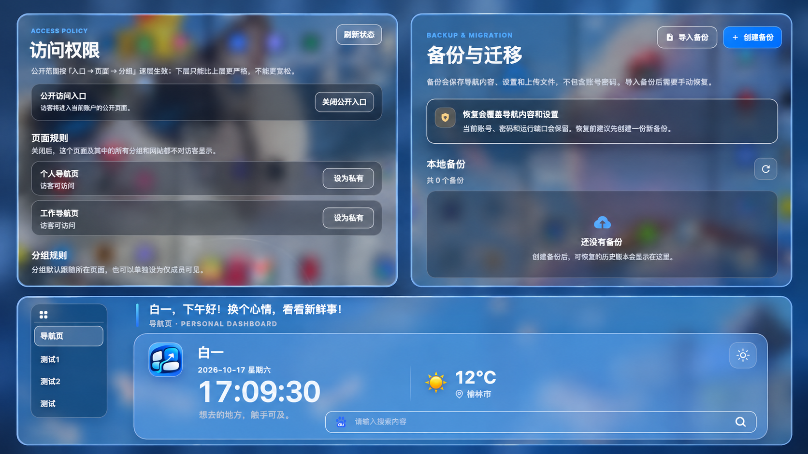
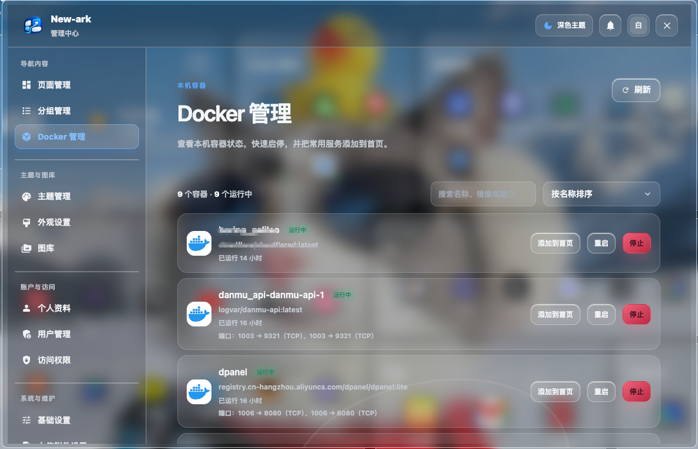
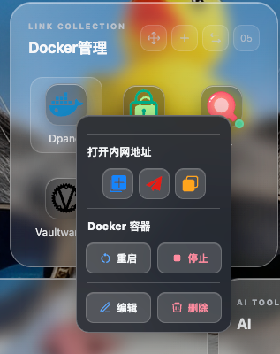

# New-ark

### 为飞牛 NAS 打造的多主题导航面板

把常用网站、NAS 服务和 Docker 容器整理到一个好看、顺手的首页。

  
  

New-ark 是一款面向飞牛 NAS（fnOS）的导航面板。网站多了，可以按用途分成不同页面；服务多了，可以通过分组和搜索快速找到；想换一种使用方式，还可以切换主题，而不用重新整理已有内容。

项目基于 Sun-Panel v1.3.0 进行二次开发，对导航首页、登录页和管理后台进行了重新设计，并加入多页面管理、自由布局、布局快照、Docker 容器联动、多用户与访问权限等功能。

## 从首页到后台，重新设计

New-ark 不只是更换配色。管理菜单、页面结构、设置表单和操作弹窗都经过重新整理，让页面、分组、网站、主题、权限和备份各有清楚的位置。

琉光首页与管理后台采用液态玻璃设计：半透明卡片、背景模糊和柔和的层次效果让壁纸融入页面，同时保持文字和操作区域清晰。界面支持浅色与深色模式，并针对较窄屏幕和移动端调整布局。

  
  

## 多主题，共用一份导航内容

New-ark 支持多主题扩展，目前内置以下主题：

- **sun-panel**：保留简洁、规整的经典导航布局。
- **琉光**：采用液态玻璃卡片，支持自由排列分组和调整卡片尺寸。

不同主题共用网站、分组、导航页面和访问权限。切换主题不需要重新添加内容；每套主题可以保留自己的视觉设置，品牌信息、搜索栏和页面布局等通用选项则由所有主题共同使用。

  

## 把琉光首页排成喜欢的样子

在桌面端，琉光主题的分组卡片可以直接拖动，也能调整宽度和高度。移动过程中会显示吸附和占位提示，卡片内的网站图标会根据可用空间调整排列与大小。移动端则会切换为更适合纵向浏览的布局。

排好的页面可以保存为**布局快照**。每个导航页面最多保存 10 份，之后可以恢复卡片的位置与尺寸；恢复布局不会修改网站内容。

  

## 多页面、访问权限与数据管理

家庭服务、工作网站、开发工具和影音娱乐可以分别放在不同页面。每个页面拥有自己的分组和网站，可以调整顺序、设置默认页，并通过首页的页面切换器快速访问。

需要分享时，可以开放访客入口，并分别控制导航页面、分组和单个网站是否对访客可见。公开内容与私人内容可以放在同一个面板中管理，不必维护两套导航。

后台支持创建、下载、导入和恢复 ZIP 备份。备份包含导航内容、相关设置和上传文件，不包含账号密码。

  

## Docker 容器与首页联动

当 New-ark 获得本机 Docker 的访问权限后，管理员可以在后台查看容器状态、镜像和端口映射，并执行启动、停止和重启操作。

常用容器可以从列表直接添加到指定页面和分组。系统会根据本机地址及映射端口生成内网地址，也可以同时保存外网地址。添加到首页后，管理员可以查看容器状态，并通过卡片右键菜单快捷控制容器。

  
  

> Docker 管理需要 New-ark 能够访问本机 Docker 服务。Docker Socket 具有较高的系统权限，请只向可信的管理员开放。

## 同一项服务，在家和在外都好打开

网站卡片可以同时保存默认地址和内网地址。打开网站时，New-ark 会尝试判断内网地址是否可用；当浏览器无法可靠判断时，则按照这张卡片预先设置的地址偏好选择。

右键菜单还可以手动打开或复制指定地址，不需要为同一项服务重复创建内网、外网两个入口。

## 多用户与访客访问

New-ark 支持管理员和普通用户，每位用户分别管理自己的导航内容。管理员可以直接创建用户，也可以审核用户提交的注册申请；有待处理的申请时，后台会显示提醒。

普通用户可以创建自己的导航页面和公开页面。未开放的页面、分组或网站仍需登录后才能访问。

## 更多功能

| 分类 | 功能 |
| --- | --- |
| 网站与图标 | 添加、编辑和排序网站；自动获取图标，或使用上传图片、文字图标和 SVG；支持裁剪、缩放与位置调整 |
| 搜索 | 切换 Google、百度和 Bing 等搜索引擎，显示搜索建议，也可以筛选当前页面的网站 |
| 首页信息 | 按需显示日期、时间和指定地区天气；琉光主题提供时段问候与随机句子 |
| 外观设置 | 明暗模式、壁纸、品牌标识、页面宽度与留白、搜索栏配色和玻璃模糊度 |
| 卡片颜色 | 统一修改当前账号所有网站卡片的背景色，也可以继续单独调整某个网站 |
| 图库 | 分类管理壁纸、图片与网站图标，上传一次即可重复使用 |
| 账户与站点 | 个人头像、显示名称、密码、浏览器标签名称与图标，以及可选的登录验证码 |
| 系统维护 | 查看 CPU、内存和磁盘状态，设置上传限制，清理缓存或恢复初始状态 |

## 下载与安装

New-ark 当前提供飞牛 NAS（fnOS）的 FPK 安装包，分别适用于 **x86_64** 和 **ARM64** 设备。

1. 前往本仓库的 [Releases](../../releases) 页面，下载与设备架构对应的 `.fpk` 文件。
2. 打开飞牛 NAS 的「应用中心」，选择「手动安装」并导入安装包。
3. 按照安装向导选择安装位置并设置运行端口。
4. 安装完成后打开 New-ark，按页面提示创建管理员账号。

具体兼容情况可能受到设备型号和 fnOS 版本影响。当前安装包要求 fnOS 1.2.0 或更高版本。

## 备份、升级与卸载

- **完整备份**保存导航内容、相关设置和上传文件，不包含账号密码。恢复前建议先为当前数据创建一份新备份。
- **布局快照**只记录琉光主题的卡片位置和尺寸，不能代替完整备份。
- **正常升级**会保留现有配置、数据库和上传文件。
- **卸载应用**会删除 New-ark 的配置、数据库、上传文件和临时文件。如需保留数据，请先创建备份，并将备份文件下载到应用目录之外。

## 项目说明与许可

New-ark 基于 [Sun-Panel](https://github.com/hslr-s/sun-panel) v1.3.0 进行二次开发，是独立项目，与 Sun-Panel 官方没有隶属关系。感谢原作者红烧猎人及其他贡献者提供的项目基础。

相关版权与许可声明见随附的 [MIT License](./LICENSE)。界面中出现的第三方产品名称、图标和商标归各自权利人所有，仅用于识别对应服务。

## 使用说明与免责声明

New-ark 按现状提供。设备环境、fnOS 版本、浏览器限制以及第三方接口状态都可能影响部分功能的实际表现。使用者应自行确认操作对象并妥善保管数据；执行容器控制、备份恢复、恢复初始状态或卸载前，请先完成必要的备份。

请在遵守当地法律法规以及相关服务条款的前提下使用本项目。因不当配置、误操作、设备故障或第三方服务变化造成的数据损失、服务中断及其他影响，由使用者自行承担。
