# New-ark

<p align="center">
  <strong>面向 NAS 与自托管场景的个人导航、网站管理与访客访问系统</strong>
</p>

<p align="center">
  多页面导航 · 液态玻璃界面 · 用户与访客访问 · 内外网智能跳转 · 飞牛 fnOS 安装包
</p>

---

## 项目简介

New-ark 是一套部署在 NAS 或个人服务器上的自托管导航系统，用于集中整理个人常用网站、工作工具、影音服务及内部系统入口。

它不仅是浏览器首页，也是可统一管理的网站入口平台：支持多页面、多分组、多用户、访客访问、内外网地址、图标图库、主题外观、数据备份与还原等功能。

项目基于 [Sun-Panel v1.3.0](https://github.com/hslr-s/sun-panel) 开源版本进行二次开发。在保留核心导航能力的基础上，针对 NAS 使用场景完成了视觉界面、交互逻辑、页面管理、访问权限和飞牛 fnOS 安装方式的深度定制。

---

## 界面预览


首页支持按场景组织网站入口。示例中展示了常用网站、影音娱乐和效率工具三个分组；实际使用时可按个人、家庭、工作或项目自由创建页面和分组。

---

## 核心特点

- 自托管部署，导航数据保存在自己的 NAS 或服务器中
- 基于 Sun-Panel v1.3.0 二次开发
- 全新液态玻璃视觉体系，支持浅色、深色与跟随系统主题
- 多页面、多分组、卡片式网站导航
- 管理员、普通用户与访客访问场景
- 内网地址优先，失败后自动回退互联网地址
- 图标自动获取、上传、图库选择与裁剪
- 首页、登录页和页面切换入口均可个性化配置
- 支持备份、迁移、恢复与缓存清理
- 提供飞牛 fnOS FPK 安装包，可在应用中心手动安装

---

# 功能说明

## 首页导航与搜索

首页是 New-ark 的核心入口。网站可按分组展示，并支持图标、名称、卡片样式和背景视觉配置。

首页可按需启用自定义品牌名称、时间、日期、天气、搜索框、首页网站卡片筛选、背景图片、主题模式、页脚文案和页面切换入口。


---

## 多页面管理

一个账号可以创建多个独立导航页面，例如个人导航、工作导航、家庭影音或项目入口。

每个页面拥有独立的网站分组和排序，可设置默认页面，并能单独控制是否允许访客访问。

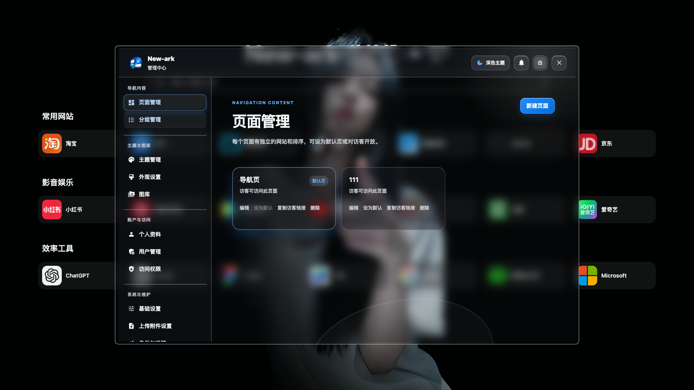

---

## 分组管理

每个导航页面可创建多个分组。分组支持命名、排序、编辑及访客可见性控制。

可按常用网站、影音娱乐、效率工具、内部系统等使用场景组织内容，使首页保持清晰有序。

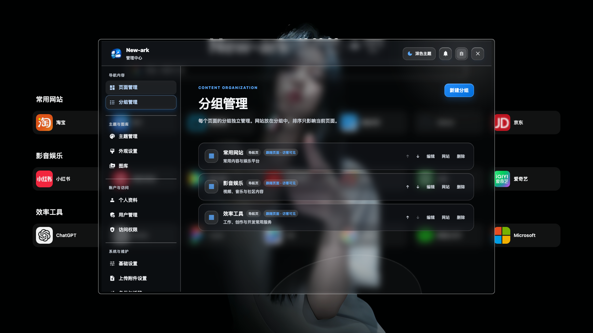

---

## 网站入口管理

每个分组内可维护多个网站卡片，支持网站名称与描述、默认访问地址和内网地址、当前页或新标签页打开、链接复制、访客可见性、卡片排序以及图标样式与背景色。

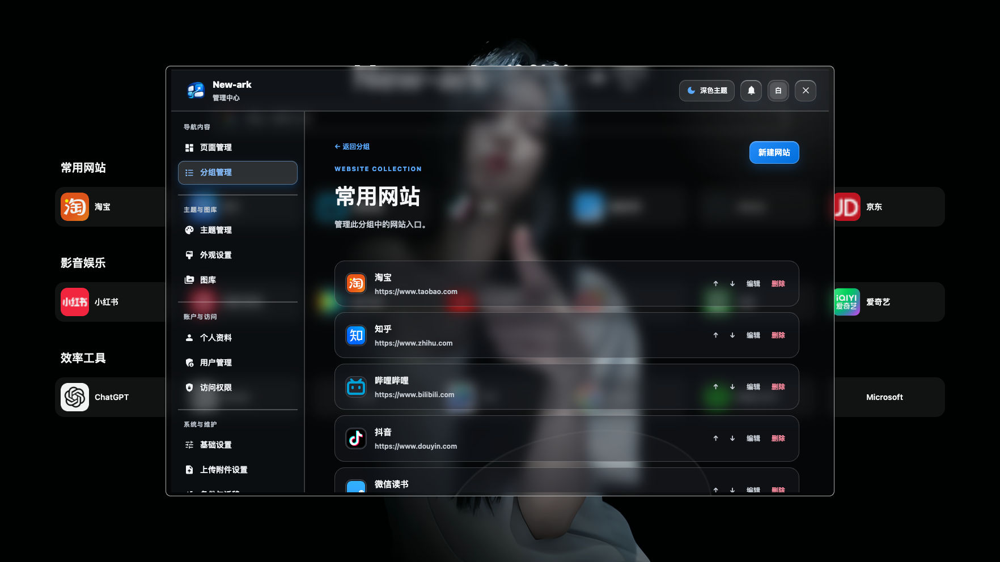

---

## 内外网智能访问

网站可同时配置互联网地址和内网或专网地址。自动模式由当前设备的浏览器预先探测内网或专网地址；可达时优先打开，确认不可达时打开互联网地址。浏览器对本地网络探测的限制可能影响判断，尤其是从公网 HTTPS 页面访问 HTTP 内网地址；此时可通过卡片右键菜单手动选择地址。

访客链接、复制链接等功能会自动使用当前访问 New-ark 的域名、IP 与端口，避免局域网和公网地址混用。

---

## 主题与首页展示设计

主题管理用于控制首页的展示风格，包括品牌名称、时间日期、天气、搜索栏、网站卡片样式、文字颜色、页面宽度和留白等。

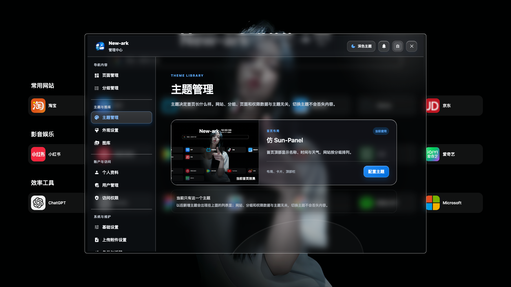

---

## 外观设置

外观设置用于管理全局展示行为，包括页面切换入口显示方式、首页页脚开关与文案、登录页背景上传、从图库选择登录页背景及其他全局外观配置。

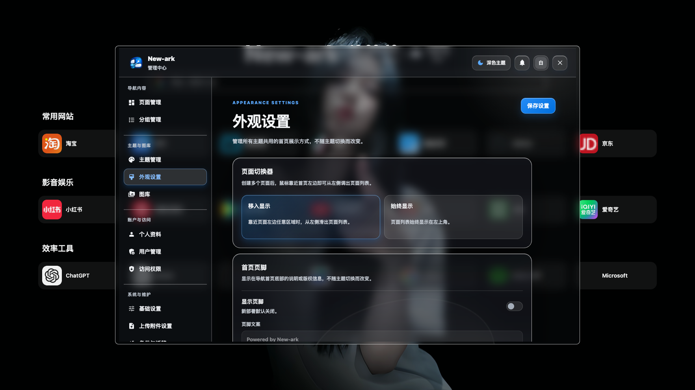

---

## 图标图库与裁剪

图库用于集中保存和复用图标、背景等素材。

新增或编辑网站时，可通过网站地址自动获取图标，也可以上传本地图标或从图库选择。图标进入网站卡片前支持缩放、拖动和居中裁剪，使不同来源的图标保持统一、协调的展示效果。

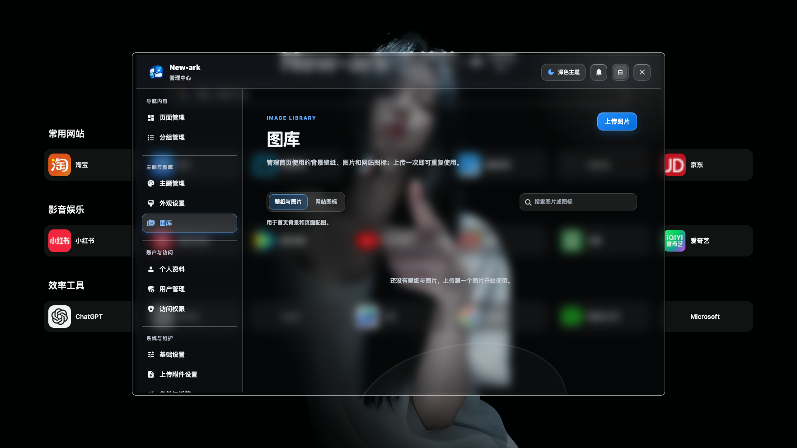

---

## 账户与个人资料

每位用户都可维护自己的显示名称、头像和导航内容。普通用户可管理个人导航页面与网站入口，管理员可统一管理系统用户。

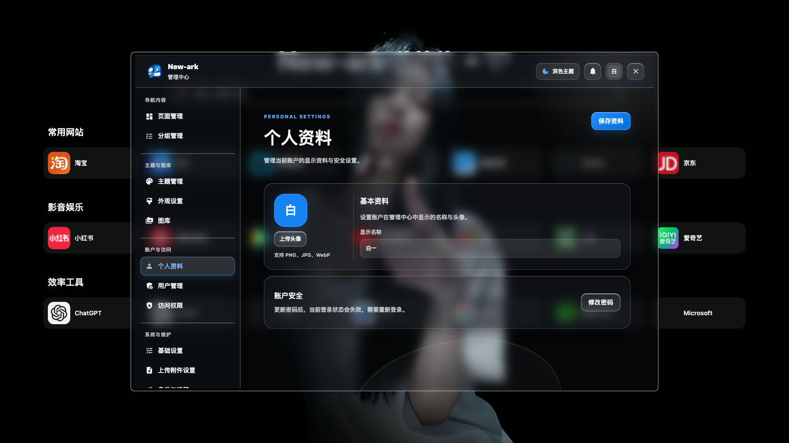

---

## 用户与注册申请

系统支持管理员和普通用户两类账号。

管理员可以查看用户列表、处理注册申请并管理账户状态；普通用户拥有独立的导航内容与个人资料。

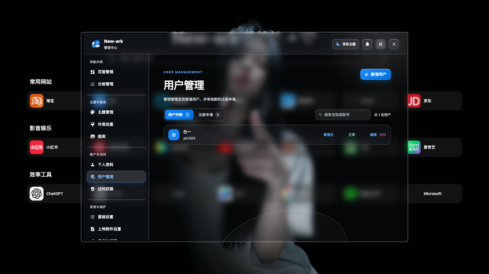

---

## 访问权限与访客页面

New-ark 支持访客访问模式。管理员可控制哪些页面、分组和网站卡片对访客显示，并可设置默认对外页面、复制和分享访客链接。

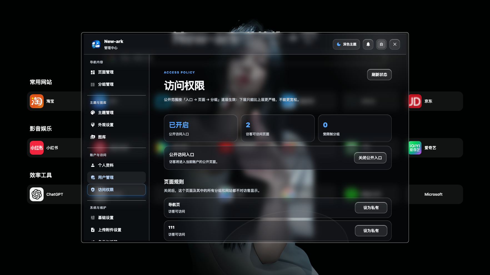

---

## 基础设置

基础设置用于管理站点级别的基础信息与系统运行相关配置。

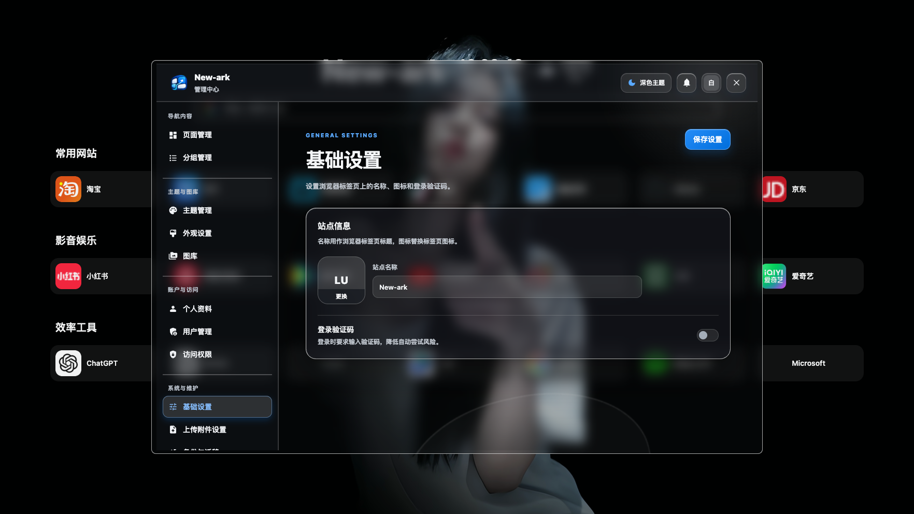

---

## 上传附件设置

上传附件设置用于管理图标、背景等素材文件的上传行为与存储规则。

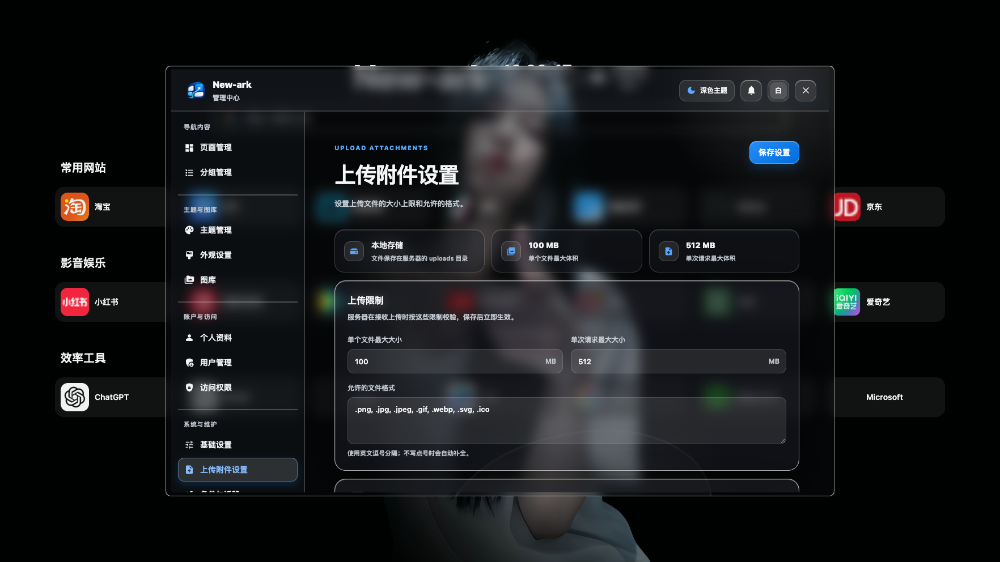

---

## 备份与迁移

系统支持备份导航页面、分组、网站卡片、外观配置和上传素材。备份文件不包含管理员及其他账号密码；导入恢复时保留当前设备的账号、密码和运行配置。更换设备或重装应用后，可先创建管理员账号，再导入备份恢复导航数据。

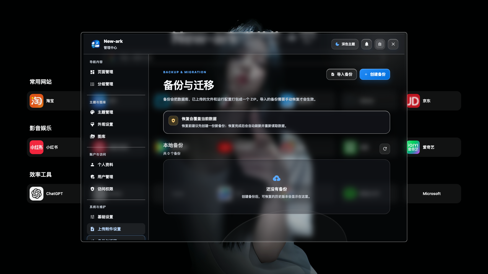

---

## 缓存与还原

缓存与还原提供系统维护能力，可用于清理缓存或恢复系统初始状态。

执行恢复初始状态前，请先完成数据备份；该操作会影响已有账号、导航内容、设置及上传素材。

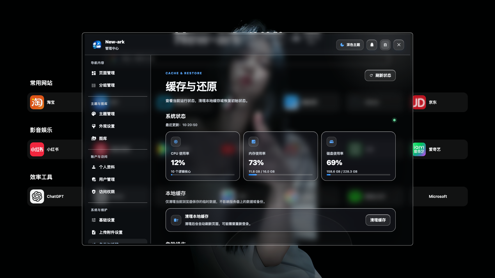

---

# 飞牛 fnOS 安装

## 安装要求

- 飞牛 fnOS 系统
- x86_64 或 ARM64 架构设备
- 一个未被占用的运行端口
- 建议使用现代浏览器访问

## 安装步骤

1. 前往 [v1.0.0 正式版发布页](https://github.com/yb1203/new-ark-release/releases/tag/v1.0.0)，x86_64 设备下载 `newark-1.0.0-x86.fpk`，ARM64 设备下载 `newark-1.0.0-arm.fpk`。
2. 打开飞牛 NAS 管理后台，进入「应用中心」。
3. 选择「手动安装」，上传下载的 FPK 文件。
4. 根据安装向导填写运行端口。
5. 安装完成后，可从飞牛桌面的 New-ark 图标打开应用。
6. 应用会以新标签页方式启动，也可通过以下地址访问：

```text
http://NAS地址:运行端口
```

首次部署后，首页默认仅显示 `New-ark` 品牌名称；日期、时间、天气和页脚默认关闭，可在后台按需启用。

---

# 版本说明

当前正式版本：`v1.0.0`

这是 New-ark 的首个正式版本。安装包、校验值及功能说明见 [v1.0.0 发布页](https://github.com/yb1203/new-ark-release/releases/tag/v1.0.0)。此前安装 v1.0.3 测试版的用户，请先导出并下载备份，再卸载旧版、安装正式版并导入备份；飞牛可能不允许直接降级。

---

# 开源项目致谢与授权说明

New-ark 基于 [Sun-Panel](https://github.com/hslr-s/sun-panel) 开源项目的 `v1.3.0` 版本进行二次开发。

- 原项目：Sun-Panel
- 原作者：红烧猎人
- 原项目地址：https://github.com/hslr-s/sun-panel
- 原项目许可证：MIT License

New-ark 保留原项目的开源致谢、版权声明和 MIT License 相关说明，详见 [NOTICE](NOTICE) 与 [LICENSE](LICENSE)。

---

# 免责声明

1. New-ark 是基于开源项目进行二次开发的独立项目，与 Sun-Panel 原作者、飞牛 fnOS 及其相关主体不存在官方隶属、授权或合作关系。
2. 本项目按“现状”提供，不提供任何明示或暗示的担保，包括但不限于稳定性、安全性、持续可用性及特定用途适用性。
3. 用户应自行负责账号安全、数据备份、端口映射、公网访问和访问权限配置。因设备故障、网络攻击、数据丢失、第三方服务变化或使用不当造成的损失，使用者应自行承担相应风险。
4. 如需将服务开放至互联网，建议自行配置强密码、访问控制、HTTPS、反向代理、防火墙及定期备份。
5. 截图中的第三方网站名称、商标、图标和服务仅用于界面示例，其相关权利归各自权利人所有。

---

# 反馈与建议

如遇安装、使用、兼容性或功能问题，欢迎在 [Issues](https://github.com/yb1203/new-ark-release/issues) 中提交反馈。

建议反馈时附上：

- New-ark 版本号
- 飞牛 fnOS 版本
- 安装方式与运行端口
- 问题复现步骤
- 必要的错误截图或日志信息
